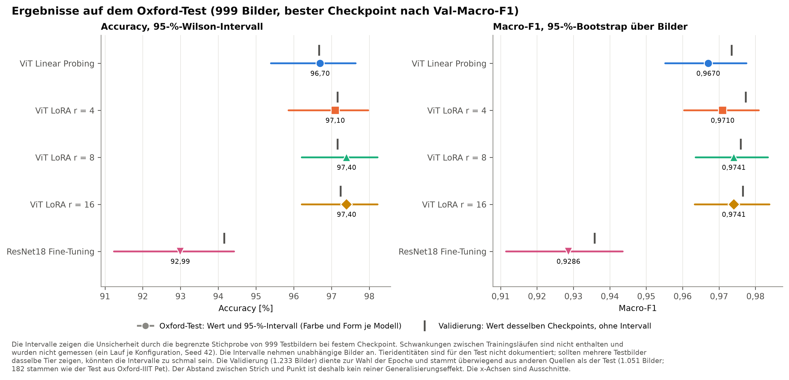

# Deep Learning: Klassifikation von Hunde- und Katzenrassen

Masterprojekt im Modul *Deep Learning for Computer Vision*, Hochschule Bielefeld (Campus Minden), Praktikum 1, Station 1 (Adaptation).

**Autoren:** Sipan Issa, Fadi Alturk

## Worum es geht

Wir vergleichen drei Wege, vortrainierte Modelle an zehn Tierrassen anzupassen:

- **Linear Probing** eines ViT-B/16: nur ein neuer Klassifikationskopf wird trainiert.
- **LoRA** auf demselben ViT-B/16 mit Rang 4, 8 und 16.
- **Fine-Tuning** eines ResNet18: alle Parameter werden trainiert.

| Katzen | Hunde |
|---|---|
| British Shorthair, Russian Blue, Persian, Ragdoll, Bengal | Samoyed, Pomeranian, Keeshond, Great Pyrenees, Newfoundland |

## Ergebnisse

Die Checkpoints wurden nach der Macro-F1 auf der Validierung (1.233 Bilder) gewählt und danach **einmalig** auf 999 Oxford-Testbildern ausgewertet (21.11.2026).

| Modell | Beste Epoche | Val-Macro-F1 | Test richtig | Test-Accuracy (95 %, Wilson) | Test-Macro-F1 (95 %, Bootstrap) |
|---|---:|---:|---:|---:|---:|
| ViT-B/16 Linear Probing | 11 von 30 | 0,9735 | 966/999 | 96,70 % (95,4–97,6) | 0,9670 (0,955–0,978) |
| ViT-B/16 LoRA r = 4 | 1 von 5 | 0,9773 | 970/999 | 97,10 % (95,9–98,0) | 0,9710 (0,960–0,981) |
| ViT-B/16 LoRA r = 8 | 3 von 10 | 0,9760 | 973/999 | 97,40 % (96,2–98,2) | 0,9741 (0,964–0,983) |
| ViT-B/16 LoRA r = 16 | 3 von 5 | 0,9766 | 973/999 | 97,40 % (96,2–98,2) | 0,9741 (0,963–0,984) |
| ResNet18 Fine-Tuning | 10 von 10 | 0,9359 | 929/999 | 92,99 % (91,2–94,4) | 0,9286 (0,911–0,944) |

- **ViT gegen ResNet18:** Alle vier ViT-Konfigurationen sind signifikant besser (exakter McNemar-Test, Holm-korrigiert p ≤ 2,1 · 10⁻⁴).
- **Linear Probing gegen LoRA und LoRA-Ränge untereinander:** kein Unterschied nachweisbar (p ≥ 0,18 ohne Korrektur). Das heißt nicht, dass die Verfahren gleich gut sind.
- **Grenzen:**
  - Es gibt einen Lauf je Konfiguration (Seed 42); die Streuung zwischen Läufen wurde nicht gemessen.
  - Epochenbudgets, Lernraten und die Skalierung α/r unterscheiden sich.
  - Beide Backbones wurden auf ImageNet-1k vortrainiert, das sechs der zehn Rassen als Klassen enthält.

Vollständige Werte: [Ergebnistabelle](results/praktikum1_station1_adaptation/oxford_test/ergebnisse_tabelle.md), [McNemar-Tests](results/praktikum1_station1_adaptation/oxford_test/mcnemar_paarweise.csv), [Diagramme](results/praktikum1_station1_adaptation/diagramme/UEBERSICHT.md).



## Modelle und Training

| Modell | Trainierbare Parameter | Epochen | Lernrate (LoRA oder Backbone / Kopf) | Dauer |
|---|---:|---:|---|---:|
| ViT-B/16 Linear Probing | 7.690 | 30 | – / 0,001 | 10,6 min |
| ViT-B/16 LoRA r = 4 | 155.146 | 5 | 0,0005 / 0,001 | 83 min |
| ViT-B/16 LoRA r = 8 | 302.602 | 10 | 0,0005 / 0,001 | 130 min |
| ViT-B/16 LoRA r = 16 | 597.514 | 5 | 0,0005 / 0,001 | 79 min |
| ResNet18 Fine-Tuning | 11.181.642 | 10 | 0,0001 / 0,001 | 20 min |

- **Gemeinsam:** AdamW, Weight Decay 0,01, Batchgröße 32, Cross-Entropy, Seed 42, Auswahl nach Val-Macro-F1.
- **LoRA:** Query und Value aller 12 Schichten, α = 16, Dropout 0,1.
- **Gewichte:** `IMAGENET1K_V1` aus torchvision; sie werden beim ersten Start geladen.
- **Vorverarbeitung:** Skalierung auf 256 Pixel, mittiger Zuschnitt auf 224 × 224, ImageNet-Normalisierung.
- **Hardware:** AMD Radeon RX 6600 mit DirectML.

## Datensatz

7.130 Originalbilder und 7.870 augmentierte Trainingsbilder, zusammen 15.000 Beispiele: 12.768 Training, 1.233 Validierung, 999 Test. Augmentiert wurde nur das Training.

| Quelle | Originalbilder | Lizenz oder Bedingung |
|---|---:|---|
| Catza | 3.702 | CC BY 3.0 (Fotograf: Heikki Siltala) |
| Oxford-IIIT Pet | 1.936 | CC BY-SA 4.0 für den Datensatz, Fotorechte bei den Inhabern |
| Stanford Dogs | 965 | stammt aus ImageNet, keine Lizenz je Bild |
| ImageNet | 260 | nur nichtkommerzielle Forschung und Lehre |
| Open Images | 133 | CC BY 2.0 je Datei |
| Openverse | 129 | CC BY, CC BY-SA oder CC0 je Datei |
| FeliBreed | 5 | CC BY 4.0 für den Datensatz |

**Dieses Repository enthält keine Datensatzbilder.** Die Rechte sind nicht für alle Quellen geklärt, und ImageNet-Bilder dürfen nicht öffentlich weitergegeben werden. Das gilt auch für die daraus augmentierten Bilder. Die Daten müssen bei den Quellen nach deren Bedingungen bezogen werden. Beschreibung: [Originalversion](data/dataset_expansion/combined_versions/20261106T110038Z/AKTIVE_VERSION_UEBERSICHT.md), [augmentierte Variante](data/dataset_expansion/augmented_versions/20261106T110038Z_15000/UEBERSICHT.md).

## Projektstruktur

```text
Deep-Learning-Pet-Breed-Classification/
├── README.md
├── requirements.txt
├── src/                                   Quellcode
│   ├── pet_dataset.py                     Klassen und Datensatz
│   ├── dataset_paths.py                   Pfade und gemeinsame Einstellungen
│   ├── vit_linear_probe.py                ViT-B/16 mit neuem Kopf
│   ├── vit_lora.py                        ViT-B/16 mit LoRA
│   ├── train_vit_linear_probe.py          Training Linear Probing
│   ├── train_vit_lora.py                  Training LoRA
│   ├── train_resnet18_adaptation.py       Training ResNet18
│   ├── train_resnet18.py                  früheres ResNet18-Training, nicht Teil des Vergleichs
│   └── evaluate_station1_oxford_test.py   einmalige Testauswertung
├── tools/                                 Prüfungen, Augmentation, Diagramme
├── data/
│   ├── final_splits/                      ursprüngliche Aufteilung mit den 999 Testbildern
│   └── dataset_expansion/                 Beschreibung der Datensatzversionen
└── results/
    ├── 20261106T110038Z_15000/seed_42/    Konfiguration und Verlauf je Lauf
    └── praktikum1_station1_adaptation/    Berichte, Diagramme, Testergebnisse
```

Ältere Berichte unter `results/` nennen die Skripte noch ohne `src/`. Sie beschreiben den Stand ihrer Entstehung und wurden nicht geändert.

## Installation

Voraussetzungen: Windows 11, Python 3.11 und eine DirectML-fähige Grafikkarte.

1. Repository herunterladen:

   ```powershell
   git clone https://github.com/Sipanissa/Deep-Learning-Pet-Breed-Classification.git
   cd Deep-Learning-Pet-Breed-Classification
   ```

2. Umgebung anlegen:

   ```powershell
   python -m venv .venv
   ```

3. Pakete installieren:

   ```powershell
   .\.venv\Scripts\python.exe -m pip install -r requirements.txt
   ```

`requirements.txt` nennt die Pakete, die der Sourcecode direkt importiert, in den verwendeten Versionen.

## Training

Alle Befehle im Hauptordner des Projekts starten, nicht in `src/`. Voraussetzung ist die Datensatzvariante unter `data/dataset_expansion/augmented_versions/20261106T110038Z_15000/` mit Bildern und CSV-Listen.

**ViT-B/16 Linear Probing**

```powershell
.\.venv\Scripts\python.exe -X utf8 src/train_vit_linear_probe.py `
  --epochs 30 --batch-size 32 --learning-rate 0.001 --seed 42
```

**ViT-B/16 LoRA, Rang 4**

```powershell
.\.venv\Scripts\python.exe -X utf8 src/train_vit_lora.py `
  --rank 4 --epochs 5 --batch-size 32 `
  --learning-rate 0.0005 --head-learning-rate 0.001 `
  --lora-alpha 16 --lora-dropout 0.1 --weight-decay 0.01 --seed 42
```

**ViT-B/16 LoRA, Rang 8**

```powershell
.\.venv\Scripts\python.exe -X utf8 src/train_vit_lora.py `
  --rank 8 --epochs 10 --batch-size 32 `
  --learning-rate 0.0005 --head-learning-rate 0.001 `
  --lora-alpha 16 --lora-dropout 0.1 --weight-decay 0.01 --seed 42
```

**ViT-B/16 LoRA, Rang 16**

```powershell
.\.venv\Scripts\python.exe -X utf8 src/train_vit_lora.py `
  --rank 16 --epochs 5 --batch-size 32 `
  --learning-rate 0.0005 --head-learning-rate 0.001 `
  --lora-alpha 16 --lora-dropout 0.1 --weight-decay 0.01 --seed 42
```

**ResNet18 Fine-Tuning**

```powershell
.\.venv\Scripts\python.exe -X utf8 src/train_resnet18_adaptation.py `
  --mode finetune --epochs 10 --batch-size 32 `
  --learning-rate 0.0001 --head-learning-rate 0.001 `
  --weight-decay 0.01 --seed 42
```

**Prüfung ohne Training:** Mit `--check-only` prüft ein Trainingsskript Daten und Modell mit einem Batch und speichert nichts:

```powershell
.\.venv\Scripts\python.exe -X utf8 src/train_vit_lora.py --rank 8 --check-only
```

Die genauen Einstellungen jedes Laufs stehen in `run_config.json`.

**Testauswertung:** Sie wurde einmalig durchgeführt und soll nicht wiederholt werden. Das Skript bricht ab, wenn der Ergebnisordner bereits existiert.

## Was fehlt und was das für die Reproduktion bedeutet

| Nicht enthalten | Folge |
|---|---|
| Datensatzbilder | Training und Auswertung sind ohne eigenen Datenbezug nicht möglich |
| CSV-Listen der 15.000er-Variante (ImageNet-Dateinamen, absolute Windows-Pfade) | Die Listen sind nur über ihre SHA-256-Prüfsummen in `run_config.json` festgelegt |
| Modellgewichte und Merkmals-Cache | Prüfsummen der Checkpoints: `results/praktikum1_station1_adaptation/oxford_test/lauf_protokoll.json` |
| Validierungsvorhersagen je Bild, ImageNet-Nachweise, geschützte Prüfsummenlisten | Die zugehörigen Auswertungen und `tools/check_project_integrity.py` laufen nur in der vollständigen lokalen Umgebung |

Testvorhersagen je Modell und Bild sind unter `results/praktikum1_station1_adaptation/oxford_test/` enthalten; die Testkennzahlen lassen sich daraus nachrechnen.

Einige ältere Berichte verweisen auf Dateien, die nicht im Repository liegen.

## Lizenz

Für den Sourcecode wurde noch keine Lizenz festgelegt; alle Rechte liegen bei den Autoren. Für Daten und vortrainierte Gewichte gelten die Bedingungen der jeweiligen Anbieter.
